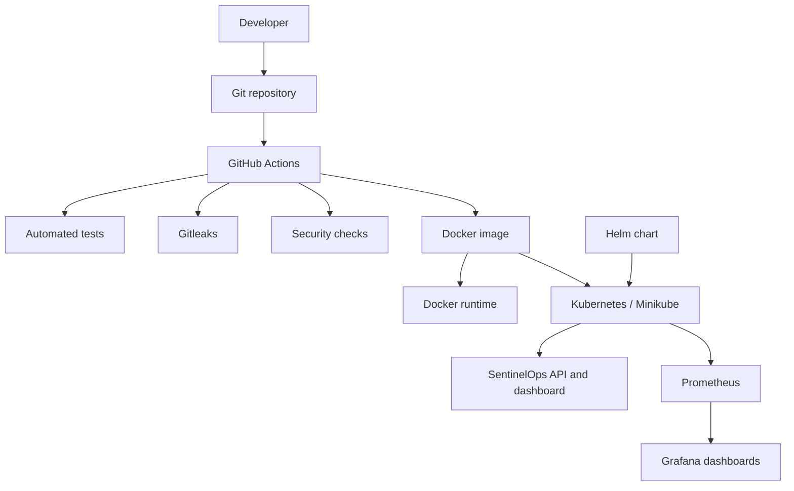
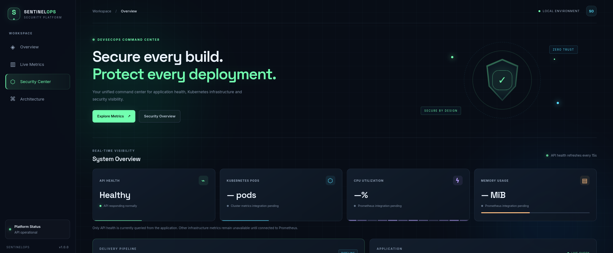

# SentinelOps - Secure DevSecOps Platform

> A portfolio project demonstrating a FastAPI application, Docker
> containerization, GitHub Actions checks, secret and container
> scanning, Kubernetes deployment with Helm, and monitoring with
> Prometheus and Grafana.


## Contents

-   [Overview](#overview)
-   [Architecture](#architecture)
-   [Features](#features)
-   [Repository layout](#repository-layout)
-   [Requirements](#requirements)
-   [Run locally](#run-locally)
-   [Run with Docker](#run-with-docker)
-   [CI and security](#ci-and-security)
-   [Kubernetes and Helm](#kubernetes-and-helm)
-   [Prometheus and Grafana](#prometheus-and-grafana)
-   [Screenshots](#screenshots)
-   [Secrets and safety](#secrets-and-safety)
-   [Troubleshooting](#troubleshooting)
-   [Fresh setup checklist](#fresh-setup-checklist)
-   [Limitations](#limitations)

## Overview

SentinelOps is a learning and portfolio project for demonstrating a
secure application delivery workflow. It includes a FastAPI backend, a
static HTML/CSS/JavaScript dashboard, a Docker image, automated checks,
Kubernetes/Helm resources, and a monitoring stack.

### Application endpoints

  Endpoint                  Purpose
  ------------------------- ---------------------------------------
  `/`                       SentinelOps dashboard
  `/health`                 Health status and UTC timestamp
  `/api/v1/info`            Application metadata
  `/docs`                   Interactive Swagger API documentation
  `/static/css/style.css`   Dashboard styling
  `/static/js/app.js`       Dashboard JavaScript

The dashboard's API health indicator checks the actual API. Only
describe CPU, memory, Kubernetes, or security panels as live
integrations when they are connected to real metrics/data.

## Architecture



Confirm the exact automation by reviewing `.github/workflows/`; this
diagram represents the overall project flow, not a promise that every
step is automatically deployed by CI.

## Features

-   FastAPI service with health and application-info endpoints.
-   Responsive static dashboard.
-   Docker image based on `python:3.12-slim`.
-   Non-root container user (`appuser`, UID/GID `10001` in the current
    Dockerfile).
-   Pytest-based automated tests.
-   GitHub Actions workflows.
-   Gitleaks secret scanning.
-   Trivy image vulnerability scanning.
-   Kubernetes deployment managed with Helm.
-   Prometheus and Grafana monitoring.
-   Screenshot documentation for portfolio review.

## Repository layout

The expected high-level structure is shown below. Confirm it against the
current checkout before publishing; optional files may differ.

``` text
sentinelops/
├── app/
│   └── main.py
├── frontend/
│   ├── index.html
│   ├── css/style.css
│   └── js/app.js
├── tests/
│   └── test_main.py
├── helm/sentinelops/
│   ├── Chart.yaml
│   ├── values.yaml
│   └── templates/
├── .github/workflows/
├── Dockerfile
├── requirements.txt
├── pytest.ini
├── .dockerignore
├── .gitignore
├── README.md
└── docs/screenshots/
```

## Requirements

### Local development

-   Git
-   Python 3.12 recommended (Docker uses Python 3.12)
-   `pip` and Python virtual environments

### Containers

-   Docker Engine

### Kubernetes and monitoring

-   A running Kubernetes cluster; Minikube is suitable for local
    practice
-   `kubectl`
-   Helm 3+
-   Enough RAM, CPU, and disk for the application and monitoring
    components
-   Network access to download dependencies, images, and charts

Record the actual versions from your environment rather than assuming
they are identical on every machine.

## Run locally

From the repository root:

``` bash
python3 -m venv .venv
source .venv/bin/activate
python -m pip install --upgrade pip
pip install -r requirements.txt
python -m pytest -v
```

Start the API:

``` bash
uvicorn app.main:app --host 0.0.0.0 --port 8000
```

Open these on the same machine: - Dashboard: `http://127.0.0.1:8000/` -
Health: `http://127.0.0.1:8000/health` - API information:
`http://127.0.0.1:8000/api/v1/info` - Swagger:
`http://127.0.0.1:8000/docs`

If `uvicorn` is not found, activate `.venv` and install
`requirements.txt`.

## Run with Docker

Build the image:

``` bash
docker build -t sentinelops-api:1.1 .
```

Run on host port `8002`:

``` bash
docker run -d \
  --name sentinelops-api \
  --publish 8002:8000 \
  --restart unless-stopped \
  sentinelops-api:1.1
```

Verify:

``` bash
docker ps --filter "name=sentinelops-api"
curl -s http://127.0.0.1:8002/health
curl -s -o /dev/null -w "Dashboard HTTP: %{http_code}\n" http://127.0.0.1:8002/
curl -s -o /dev/null -w "CSS HTTP: %{http_code}\n" http://127.0.0.1:8002/static/css/style.css
curl -s -o /dev/null -w "JS HTTP: %{http_code}\n" http://127.0.0.1:8002/static/js/app.js
```

Dashboard, CSS, and JS should return HTTP `200`; `/health` should report
`"status":"healthy"`.

Open `http://127.0.0.1:8002/` in a browser on the Docker host. If Docker
runs inside a VM and the browser is on Windows, use the VM's reachable
IP address instead of `127.0.0.1`; configure VM networking/firewall
accordingly.

Stop/remove the demo container only when intended:

``` bash
docker stop sentinelops-api
docker rm sentinelops-api
```

## CI and security

Review `.github/workflows/` to see the exact jobs and triggers. The
maintainer reports that the project's workflows passed at the time of
writing; rerun them after changes and use the actual GitHub Actions logs
as evidence.

### Tests

``` bash
python -m pytest -v
```

### Gitleaks

Gitleaks scans source/history for patterns that may indicate committed
secrets. A successful scan does not guarantee that a credential has
never been exposed.

### Trivy

If Trivy is installed and the image exists locally, scan it with:

``` bash
trivy image sentinelops-api:1.1
```

Save the real scan output and document the scan date, image tag,
severity counts, and remediation status. A completed scan does not
necessarily mean zero vulnerabilities.

### Non-root container check

``` bash
docker exec sentinelops-api id
```

The current Dockerfile is intended to run as `appuser` with UID/GID
`10001`. Never bake secrets into the image.

## Kubernetes and Helm

Verify the tools and cluster:

``` bash
minikube status
kubectl cluster-info
kubectl get nodes
helm version
```

If Minikube is stopped, start it:

``` bash
minikube start
```

Inspect and validate the chart:

``` bash
find helm/sentinelops -maxdepth 3 -type f
cat helm/sentinelops/Chart.yaml
cat helm/sentinelops/values.yaml
helm lint helm/sentinelops
helm template sentinelops helm/sentinelops --namespace sentinelops
```

Before deploying, confirm `values.yaml` points to an image
repository/tag the Kubernetes nodes can actually pull. An image built in
the host's Docker daemon is not automatically available inside every
Kubernetes runtime.

Install or upgrade the chart:

``` bash
helm upgrade --install sentinelops ./helm/sentinelops \
  --namespace sentinelops \
  --create-namespace
```

Verify the actual release and resources:

``` bash
helm list -A
helm status sentinelops -n sentinelops
kubectl get all -n sentinelops
kubectl get pods -n sentinelops -o wide
kubectl get services -n sentinelops
kubectl get networkpolicies -n sentinelops
kubectl get role,rolebinding -n sentinelops
```

If the release name or namespace differs, use the actual values from
`helm list -A`. Avoid publishing secrets or sensitive rendered
configuration.

## Prometheus and Grafana

The maintainer reports completing monitoring with senior colleagues. Use
the commands below to verify the current environment; a previous
successful setup does not mean services are always running.

``` bash
minikube status
kubectl get pods -n monitoring
kubectl get services -n monitoring
helm list -n monitoring
```

If pods are not ready, inspect before reinstalling:

``` bash
kubectl describe pods -n monitoring
kubectl get events -n monitoring --sort-by=.lastTimestamp
```

Use `kubectl get services -n monitoring` to find the actual service
names and ports. Example port-forward commands (replace placeholders and
target ports with the actual service values):

``` bash
kubectl port-forward -n monitoring svc/<prometheus-service> 9090:<service-port>
kubectl port-forward -n monitoring svc/<grafana-service> 3000:<service-port>
```

Run each port-forward in its own terminal and keep it open while using
the browser: - Prometheus: `http://127.0.0.1:9090` - Grafana:
`http://127.0.0.1:3000`

Grafana credentials depend on the chart/configuration. Retrieve them
using the chart's documented secret instructions; never commit passwords
or tokens to GitHub.

Useful monitoring evidence: - Prometheus Targets page with real scrape
statuses. - Prometheus graph page with a real query/result. - Grafana
dashboard with real metrics. - Monitoring pods/services and Helm release
status.

Do not present generated mockups as evidence of real telemetry. If a
panel has no data, label it as pending and troubleshoot the source.

## Screenshots

Create a place for evidence:

``` bash
mkdir -p docs/screenshots
```

Suggested filenames (keep only screenshots that actually exist):

``` text
docs/screenshots/
├── 01-sentinelops-dashboard.png
├── 02-api-health.png
├── 03-api-swagger-docs.png
├── 04-docker-container.png
├── 05-docker-image.png
├── 06-docker-nonroot-security.png
├── 07-github-actions-success.png
├── 08-automated-tests.png
├── 09-gitleaks-secret-scan.png
├── 10-security-workflow.png
├── 11-trivy-vulnerability-scan.png
├── 12-kubernetes-cluster.png
├── 13-kubernetes-pods.png
├── 14-kubernetes-deployments.png
├── 15-kubernetes-services.png
├── 16-helm-release.png
├── 17-kubernetes-network-policies.png
├── 18-kubernetes-rbac.png
├── 19-monitoring-pods.png
├── 20-monitoring-services.png
├── 21-prometheus-targets.png
├── 22-prometheus-query.png
├── 23-grafana-cluster-overview.png
├── 24-grafana-resource-usage.png
├── 25-helm-lint.png
└── 26-helm-release-status.png
```

Embed real screenshots with relative links, for example:

``` markdown

```

Before committing screenshots, check that they do not expose tokens,
passwords, `.env` values, private keys, personal information, or other
sensitive data. Crop images to make evidence readable. Do not add
mockups as if they were genuine screenshots.

## Secrets and safety

-   Keep passwords, API keys, cloud credentials, and tokens out of
    source code and screenshots.
-   Use GitHub Actions secrets for CI credentials.
-   Do not commit `.env` files, kubeconfig files, private keys, or
    manifests containing real secrets.
-   Apply least-privilege Kubernetes RBAC and service accounts.
-   Rotate any credential accidentally exposed; removing it from the
    latest commit may not remove it from Git history.
-   Do not expose development ports publicly without appropriate access
    controls.

## Troubleshooting

### CSS/JS returns 404

Ensure the Dockerfile copies the frontend into the image:

``` dockerfile
COPY --chown=appuser:appgroup frontend/ ./frontend/
```

Rebuild the image and recreate the container after Dockerfile changes.
Check logs:

``` bash
docker logs sentinelops-api
```

### Port 8002 is already in use

Identify the container publishing it:

``` bash
docker ps --filter "publish=8002"
```

Do not terminate processes blindly; identify the service first.

### Kubernetes pods are Pending or restarting

``` bash
kubectl get pods -A
kubectl describe pod <pod-name> -n <namespace>
kubectl logs <pod-name> -n <namespace> --all-containers=true
kubectl get events -n <namespace> --sort-by=.lastTimestamp
```

Replace placeholders with real names.

### Prometheus/Grafana will not open

-   Check `minikube status`.
-   Check monitoring pods and services.
-   Confirm the correct service name and port.
-   Keep the port-forward process running.
-   Inspect pod logs/events before reinstalling the stack.

### Helm validation fails

``` bash
helm lint helm/sentinelops
helm template sentinelops helm/sentinelops --namespace sentinelops
```

Resolve reported chart/template errors before upgrading the release.

## Fresh setup checklist

For someone cloning the project for the first time:

1.  Install Git, Python, Docker, `kubectl`, Helm, and Minikube as needed
    for the chosen parts.
2.  Clone this repository and review the Dockerfile, workflows,
    requirements, and Helm values.
3.  Create a Python virtual environment and install `requirements.txt`.
4.  Run `python -m pytest -v`.
5.  Run the API locally and test `/`, `/health`, `/api/v1/info`, and
    `/docs`.
6.  Build and run the Docker image; verify the dashboard, CSS, and JS.
7.  Push a branch or open a pull request to run the configured GitHub
    Actions workflows.
8.  Run Gitleaks and Trivy according to the repository configuration and
    save actual results.
9.  Start a Kubernetes cluster and verify `kubectl` access.
10. Run `helm lint` and `helm template`; configure the image reference
    for the cluster.
11. Install/upgrade SentinelOps with Helm and verify pods, services,
    NetworkPolicies, and RBAC.
12. Verify Prometheus/Grafana services, start port-forwards, and confirm
    actual metrics.
13. Capture genuine screenshots and save them under `docs/screenshots/`.
14. Update this README so filenames, versions, scan findings, commands,
    and workflow names match the final repository.

## Limitations and future improvements

This is a learning/portfolio project, not a production-readiness
guarantee. CI passing does not prove zero defects or vulnerabilities.
Image vulnerabilities change as base images and databases change, so
record the scan date and actual findings. Review TLS, authentication,
authorization, resource limits, secret management, image provenance,
alerting, backup, and recovery before production use.

Potential next improvements: - Publish versioned images and generate an
SBOM. - Sign images and add provenance/attestation. - Add deployment
approvals, smoke tests, and rollback automation. - Add
application-specific Prometheus metrics and Grafana dashboards managed
as code. - Add alert rules and operational runbooks. - Add a `LICENSE`
file if explicit reuse/distribution rights are desired.

## Maintainer

Maintained as a DevSecOps learning and portfolio project by the
repository owner.
